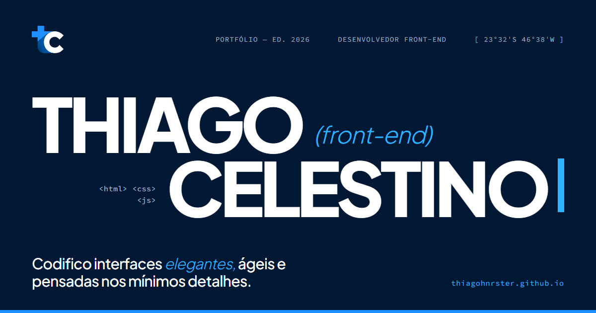

# Thiago Celestino — Portfólio

Portfólio de desenvolvedor front-end, em português e inglês.

**[thiagohnrster.github.io](https://thiagohnrster.github.io/)**



## Stack

- HTML, CSS e JavaScript, sem framework
- [GSAP](https://gsap.com/) + ScrollTrigger para as animações
- [Vite](https://vite.dev/) para o build
- GitHub Pages, com deploy automático pelo GitHub Actions

## Destaques

- **Transição entre páginas.** A prévia do projeto se transforma na imagem de topo do case, com View Transitions entre documentos. No Firefox e no Safari antigo, uma versão própria em GSAP imita o mesmo movimento.
- **Site "compilando".** Cada seção aparece primeiro como um esqueleto com as tags reais e é revelada por um cursor de terminal.
- **Duas línguas.** O português é a fonte. As páginas em `/en/` são geradas por um script (`tools/i18n/build_en.py`), com `hreflang`, canonical e dados estruturados próprios.
- **Desempenho e SEO.** Lighthouse 95–100 em desempenho, 96 em acessibilidade e 100 em SEO. Imagens em WebP com `srcset`, fontes self-hosted e JSON-LD (schema.org) em todas as páginas.
- **Respeita `prefers-reduced-motion`.** Sem animações para quem desativou movimento no sistema.

## Rodando localmente

```bash
npm install
npm run dev       # http://localhost:5173
npm run build     # gera o site em dist/
npm run preview   # serve o dist/ em http://localhost:4173
```

Depois de mudar texto ou estrutura em português, gere de novo as páginas em inglês (Python 3, sem dependências):

```bash
python tools/i18n/build_en.py
```

## Estrutura

```
index.html          home
projetos/           uma página por case
en/                 versão em inglês (gerada, não editar à mão)
404.html            página de erro (PT/EN)
js/site.js          animações e interações
styles/css/         CSS e fontes
public/             arquivos copiados como estão (loader, CV, sitemap, imagens de compartilhamento)
tools/i18n/         gerador da versão em inglês
```
